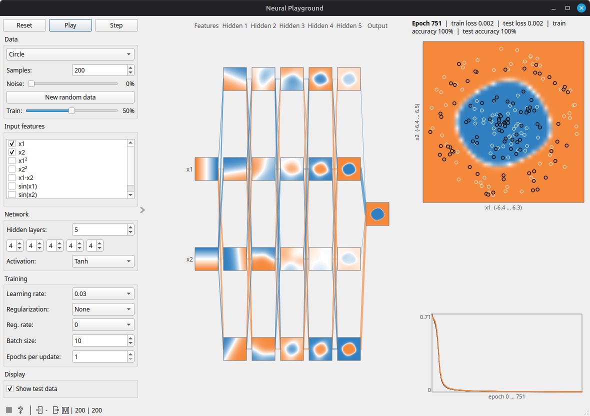
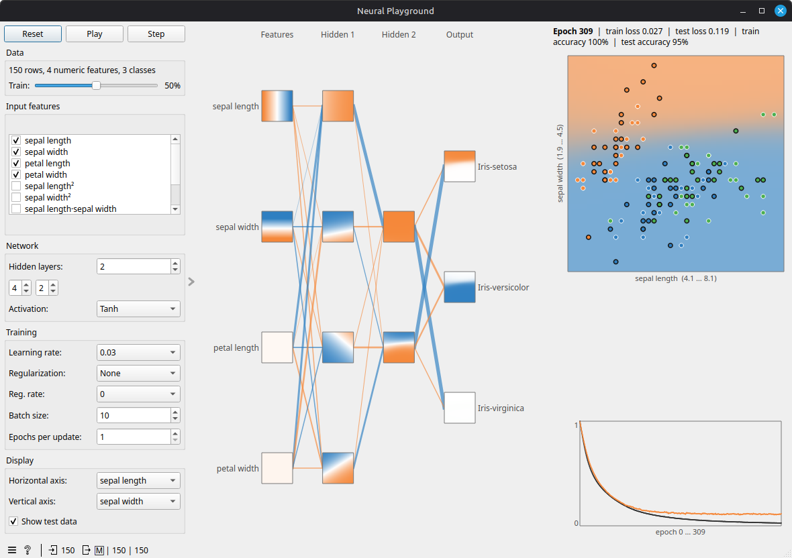
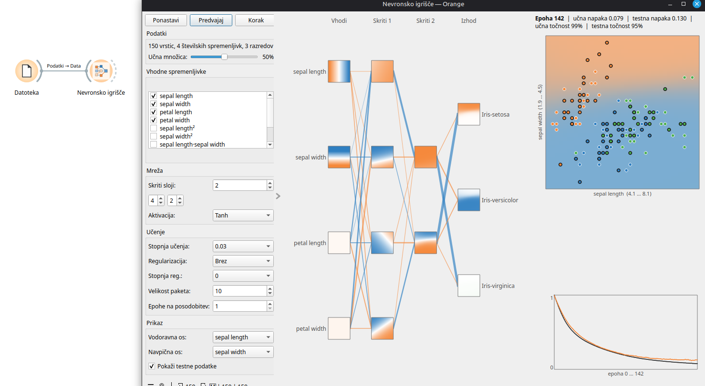
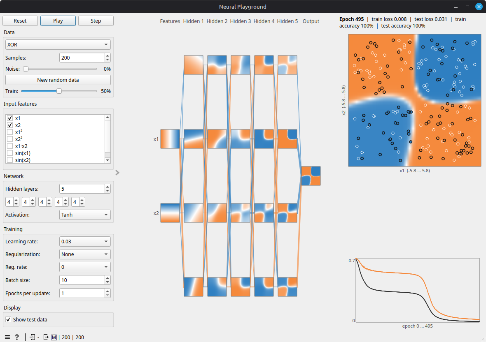
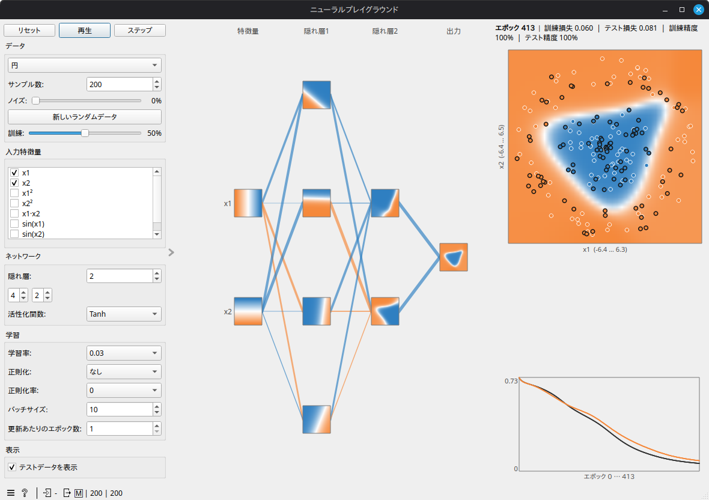

# Neural Playground

Build a small neural network, train it step by step and watch what it learns.

**Inputs**

- Data (optional): a table with at least two numeric features and a class (categorical) or numeric target. Without an input the widget generates the built-in data sets, so it works on its own.

**Outputs**

- Model: the trained network, for *Predictions*, *Test and Score* and the like. It is a copy of the network at the moment it was sent.
- Data: the rows used, with a `Subset` column that says whether each row is in the **train** or the **test** set.
- Hidden Layer Output: the activations of the last hidden layer for every row (`h1`, `h2`, ...), with the class and the `Subset` column. This is what the network "sees" just before its output, so feed it to *Scatter Plot* to check that the classes became separable. Empty when there are no hidden layers.

Outputs are sent when the network is reset, stepped or paused, not on every update while it plays.

## Reading the window

The screenshot above shows the widget with the `iris` data connected: four input features, two hidden layers, and one output tile per class.

- **Network diagram** (centre). One column per layer. Each tile is a heat map of one neuron's output over the plane of the two chosen axes: blue is positive, orange negative, white about zero. The first column shows the input features, the last the output. **Edges** are the weights: blue positive, orange negative, thicker means larger. Hover an edge for the weight, or a tile for its bias.
- **Output** (right). The network's decision over the plane with the data on top. Points with a white outline are training data, points with a dark outline are test data. For classification, colour is the predicted class (a mix where the network is unsure); for regression, blue is a high value and orange a low one.
- **Loss curve**. Training loss (dark) and test loss (orange) per epoch. A test loss that rises while the training loss keeps falling is overfitting.

## Using your own data

Connect any table with at least two numeric features and a class or numeric target, for example from the *File* widget. The data generator is replaced by a summary of the table, and every numeric column becomes an input feature.

## Controls

**Reset / Play / Step**: *Reset* starts again from new random weights, *Play* trains until you press *Pause*, *Step* trains one epoch (one pass over the training data).

**Data**

- With no input: choose the data set (see *Playground Data*), the number of samples and the noise, or press *New random data*.
- **Train**: the percentage of rows used for training; the rest are test rows that the network never learns from.

**Input features**

Tick the inputs the network gets. They are the data's numeric columns, plus five features the Playground offers, calculated from the **first two** numeric columns (`x1` and `x2`): x1², x2², x1·x2, sin(x1) and sin(x2). Each is scaled to [-1, 1] using the training rows. These let a network with no hidden layers draw a circle (with the squares) or solve XOR (with x1·x2), and they help a lot with the spiral.

**Network**

- **Hidden layers**: 0 to 6. With none, the network is a logistic (or linear) model that can only draw straight lines.
- The spin boxes below set the **neurons** in each layer (1 to 8).
- **Activation**: ReLU, tanh, sigmoid or linear (a linear network is just a linear model however many layers it has).

Changing the input features, layers, neurons, activation or train fraction rebuilds the network and starts training again.

**Training** (these take effect immediately, mid-training)

- **Learning rate**: the size of each step. Too small and it crawls; too large and the loss jumps around or the network diverges (the widget then pauses and warns).
- **Regularization** and **Reg. rate**: L1 (pushes weights to exactly zero, so unused connections vanish) or L2 (keeps all weights small). Raise the rate to fight overfitting.
- **Batch size**: rows per weight update. Small batches give noisier but more frequent updates.
- **Epochs per update**: how many epochs to train between screen updates, for speeding up large networks or data.

**Display**

- **Horizontal / Vertical axis**: shown when the data has more than two numeric columns. Chooses which two columns span the plane in the heat maps. The other columns are held at their average, so the picture is a slice through your data.
- **Show test data**: hide the test points.

## How it learns

The network is a fully connected feed-forward network trained with mini-batch stochastic gradient descent (plain backpropagation, no momentum), implemented in numpy. The output and loss depend on the target:

- Two classes: one sigmoid output and cross-entropy loss.
- More than two classes: a softmax output per class and cross-entropy loss.
- Numeric target: one linear output and squared-error loss.

The loss shown is the data loss only, without the regularization term. Rows with missing values are ignored. Categorical input features are ignored; only numeric columns are used.

## Things to try

1. **Circle** with only x1 and x2 and no hidden layers: it cannot do it. Tick x1² and x2² and it can.
2. **XOR** with a hidden layer of two or more neurons, or just the x1·x2 feature.

   
3. **Spiral** with 8-8 neurons and all the features, then add noise and watch the test loss climb as the network overfits. Turn on L2 regularization to calm it.
4. Raise the **learning rate** to 3 or 10 and watch it fail.
5. Connect a real table, such as `iris`, and compare the *Model* with a decision tree in *Test and Score*.

## Languages

The widget follows Orange's interface language setting: English, Slovenian, Spanish and Japanese are included. Restart Orange after changing it.

